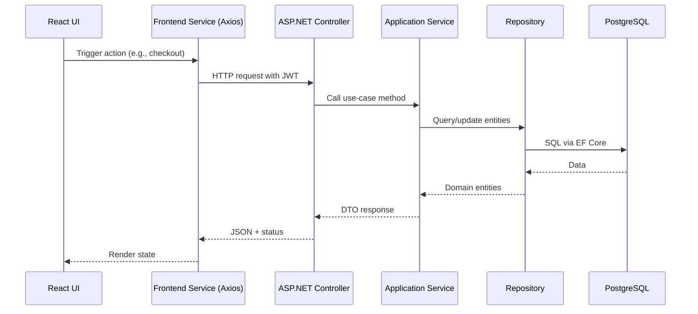
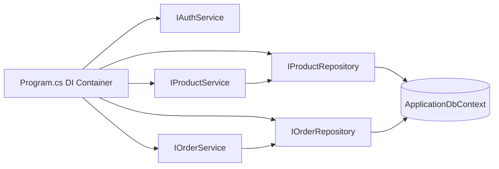

# Architecture

## React to API flow

The frontend calls backend REST endpoints through Axios from service modules.

Flow:
1. React pages and components trigger service calls.
2. Service functions call Axios client methods.
3. Axios sends HTTP requests to the API.
4. Controllers validate and route requests to services.
5. Services apply business rules and use repositories.
6. Repositories use EF Core DbContext to query/update PostgreSQL.
7. Responses are mapped to DTOs and returned to the frontend.

## Layers and responsibilities

### Controllers

Controllers in the API project handle:
- HTTP transport concerns
- Route and parameter binding
- Authorization attributes and user claim extraction
- Calling application services

Examples:
- Auth endpoints in [backend/MyStreet.Api/Controllers/AuthController.cs](../backend/MyStreet.Api/Controllers/AuthController.cs)
- Product endpoints in [backend/MyStreet.Api/Controllers/ProductsController.cs](../backend/MyStreet.Api/Controllers/ProductsController.cs)
- Order endpoints in [backend/MyStreet.Api/Controllers/OrdersController.cs](../backend/MyStreet.Api/Controllers/OrdersController.cs)

### Services

Services implement business logic, including:
- Product normalization and validation
- Order stock checks, ownership checks, and totals
- Authentication workflows

Examples:
- [backend/MyStreet.Infrastructure/Services/ProductService.cs](../backend/MyStreet.Infrastructure/Services/ProductService.cs)
- [backend/MyStreet.Infrastructure/Services/OrderService.cs](../backend/MyStreet.Infrastructure/Services/OrderService.cs)
- [backend/MyStreet.Infrastructure/Services/AuthService.cs](../backend/MyStreet.Infrastructure/Services/AuthService.cs)

### Repositories

Repositories handle persistence details:
- Query filtering and sorting
- Entity tracking concerns
- Save operations

Examples:
- [backend/MyStreet.Infrastructure/Repositories/ProductRepository.cs](../backend/MyStreet.Infrastructure/Repositories/ProductRepository.cs)
- [backend/MyStreet.Infrastructure/Repositories/OrderRepository.cs](../backend/MyStreet.Infrastructure/Repositories/OrderRepository.cs)

### EF Core

EF Core is used through `ApplicationDbContext`:
- Entity mappings and relationships
- Precision rules for money values
- Cascade/restrict delete behavior

Reference:
- [backend/MyStreet.Infrastructure/ApplicationDbContext.cs](../backend/MyStreet.Infrastructure/ApplicationDbContext.cs)

### PostgreSQL

PostgreSQL is the primary database:
- Reliable relational storage for users, products, orders, and order items
- Well-supported by Npgsql provider and EF Core migrations

Connection configuration:
- [backend/MyStreet.Api/appsettings.json](../backend/MyStreet.Api/appsettings.json)

## DTO separation

DTOs in the Application layer separate API contracts from persistence/domain entities.

Why this helps:
- Reduces accidental overexposure of internal fields
- Keeps API shape stable while entities evolve
- Makes validation and mapping explicit

Examples:
- Request DTOs in [backend/MyStreet.Application/Contracts](../backend/MyStreet.Application/Contracts)
- Domain entities in [backend/MyStreet.Domain/Entities](../backend/MyStreet.Domain/Entities)

## Dependency Injection

The app registers interfaces to implementations in startup configuration.

Benefits:
- Loose coupling
- Easier testing with mocks
- Clear composition root

Registration reference:
- [backend/MyStreet.Api/Program.cs](../backend/MyStreet.Api/Program.cs)

## SOLID principles used

- Single Responsibility Principle:
- Controllers manage transport, services manage business logic, repositories manage persistence.

- Open/Closed Principle:
- New services/repositories can be introduced behind interfaces without changing callers.

- Liskov Substitution Principle:
- Consumers use service/repository interfaces and remain agnostic to concrete types.

- Interface Segregation Principle:
- Small focused interfaces, such as `IOrderService` and `IProductRepository`.

- Dependency Inversion Principle:
- High-level logic depends on abstractions from the Application layer.

## Why Clean Architecture is lightweight here

This project applies Clean Architecture ideas without heavy ceremony:
- Layered folders and interfaces
- Contract and domain boundaries
- Infrastructure implementations behind abstractions

It stays lightweight by avoiding:
- Excessive project fragmentation
- Overly complex mediator/pipeline patterns
- Advanced enterprise infrastructure that is unnecessary for a local foundation app

## Why cart uses localStorage

The cart is intentionally client-side:
- Fast UX with no extra API calls
- Works for anonymous and authenticated browsing
- Reduces backend complexity for foundation stage

This is implemented in:
- [frontend/mystreet-ui/src/utils/cartStorage.ts](../frontend/mystreet-ui/src/utils/cartStorage.ts)

## Why JWT was selected

JWT is a good fit for this project because:
- It enables stateless API authentication
- It works well with SPA + API architecture
- It is simple to integrate with ASP.NET authentication middleware

Security configuration is in:
- [backend/MyStreet.Api/Program.cs](../backend/MyStreet.Api/Program.cs)

## Why IsAdmin was selected instead of full RBAC

A single `isAdmin` claim is used for admin gates because:
- It covers current access needs (admin product management)
- It is easy to reason about in early stages
- It avoids overengineering role/permission management before needed

If requirements grow, this can evolve into full RBAC with roles and permission matrices.
